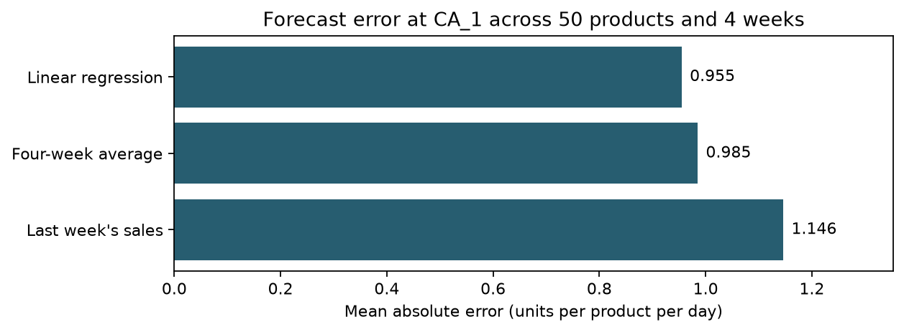

# Retail Demand Forecasting

Can a linear regression forecast daily unit sales more accurately than repeating
last week's sales or averaging the four previous matching weekdays?

## Results

I tested 50 sampled products at store `CA_1` over four consecutive
7-day forecasts. Each product and day received equal weight.

| Forecast method | MAE (units per product per day) |
|---|---:|
| Linear regression | 0.955 |
| Four-week average | 0.985 |
| Last week's sales | 1.146 |

## Where sales exceeded the forecast

For 14 of the 50 products, weekly sales exceeded
the four-week average forecast in at least three of the four test weeks.
These products are candidates for a closer look during weekly planning.

## How I tested the forecasts

- Sampled products with a fixed random seed of 42.
- Compared last week's sales, a four-week same-weekday average and linear regression.
- Fitted one regression per product before each forecast week using sales from
  7, 14, 21 and 28 days earlier.
- Used SQLite to count underforecast weeks for each product.

The results cover one store and four test weeks. Recorded sales alone cannot
show whether zero sales resulted from a stockout.

## Reproduce the analysis

1. Download the [M5 Forecasting – Accuracy data](https://www.kaggle.com/competitions/m5-forecasting-accuracy/data).
2. Place `calendar.csv`, `sales_train_validation.csv` and
   `sales_train_evaluation.csv` in `data/raw/`.
3. Install pandas, matplotlib, scikit-learn and ipykernel in a Python environment.
4. Open `01_first_forecast.ipynb` from the project root, select that environment
   as the notebook kernel and run all cells in order.
